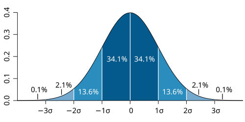
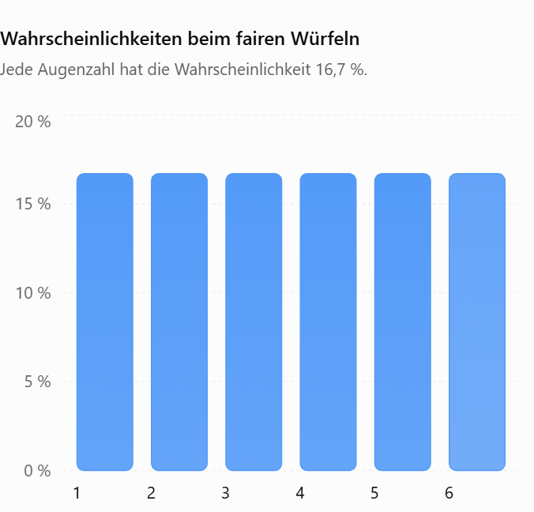
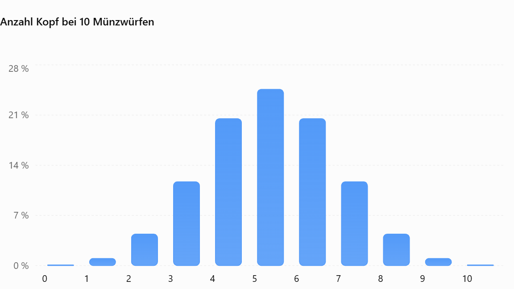
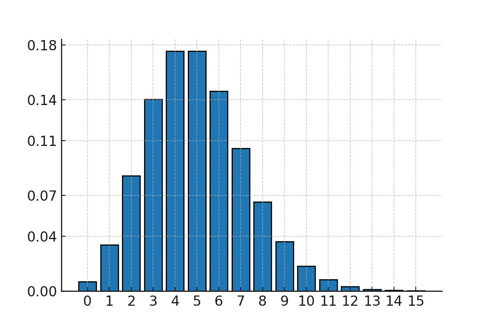

# Wahrscheinlichkeitsverteilungen

## Normalverteilung

## Gleichverteilung

## Binomialverteilung

## Poisson-Verteilung

## Übersicht

| Verteilung         | Typische Anwendung                                 |
| ------------------ | -------------------------------------------------- |
| Gleichverteilung   | Alle Ergebnisse sind gleich wahrscheinlich         |
| Normalverteilung   | Messwerte streuen um einen Mittelwert              |
| Binomialverteilung | Anzahl Erfolge bei einer festen Zahl von Versuchen |
| Poisson-Verteilung | Anzahl Ereignisse pro Zeitintervall                |
