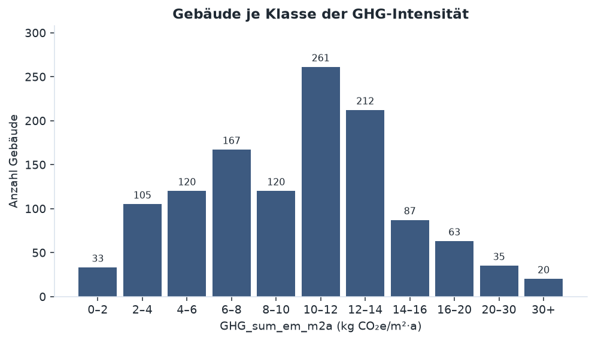
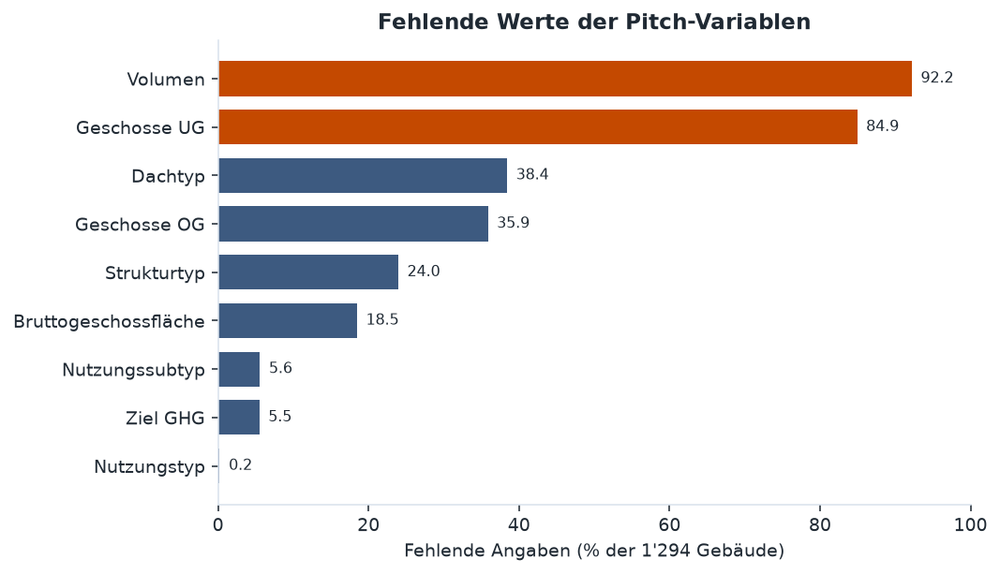
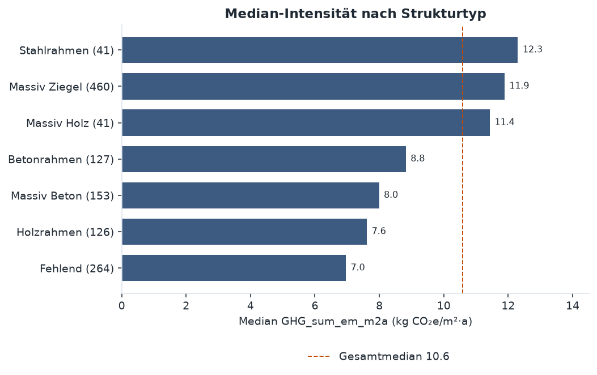
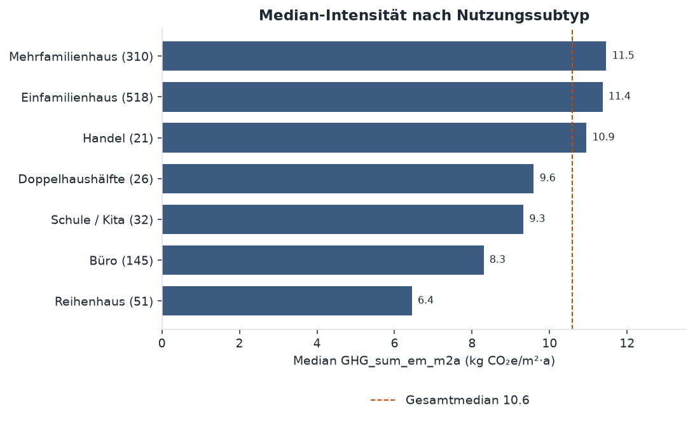
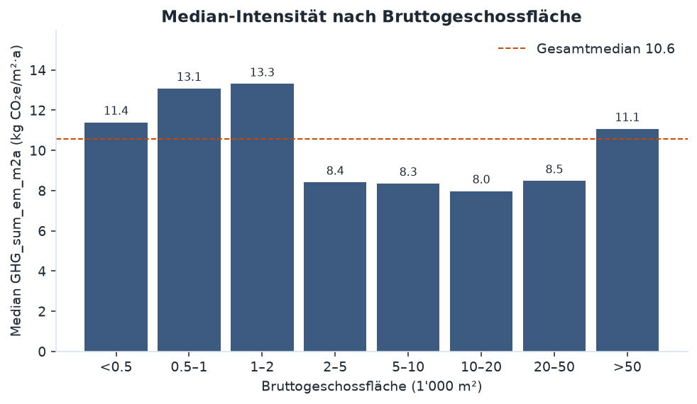
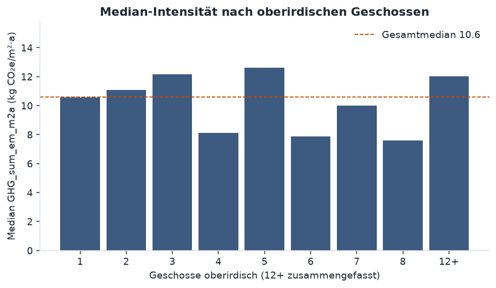
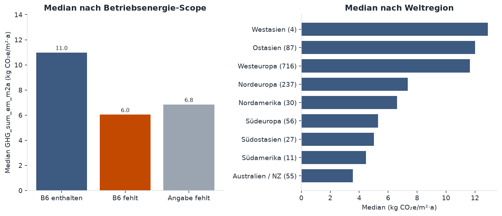

# Explorative Analyse: GHG-Intensität aus Gebäudeparametern

**Daten:** CarbEnMats GBDB, `gbdb_data_full.csv` (1'294 Gebäude). «No data» gilt als fehlend.  
**Ziel:** `GHG_sum_em_m2a`, Whole-Life-Carbon-Intensität in kg CO₂e/m²·a.  
**Prädiktoren:** die acht frühen Gebäudeparameter aus dem [Projekt-Pitch](../docs/projekt_pitch.md).  
**Abbildungen:** `notebooks/eda_gebaeudeparameter.py` (Rohdaten lokal in `data/raw/`, nicht im Git).

Die Zielvariable ist dicht belegt und rechtsschief. Die acht Prädiktoren sind gemeinsam fast nie vollständig. Fläche, Volumen und Geschosse hängen untereinander stark zusammen, mit der Intensität aber kaum.

## Zielvariable

Von 1'294 Gebäuden haben 1'223 einen Zielwert. Median 10.6 kg CO₂e/m²·a, Mittel 10.5, Standardabweichung 6.1, Spanne von nahe 0 bis 64.8. Das 5-%- und das 95-%-Perzentil liegen bei 2.7 und 19.3. Die Schiefe beträgt 2.3. 44 Gebäude (3.6 % der beobachteten Werte) liegen über der 1.5-IQR-Grenze von 22.0.

## Fehlende Werte

| Variable | Fehlend | Anteil |
|----------|--------:|-------:|
| `bldg_volume_gbv` | 1'193 | 92.2 % |
| `bldg_floors_bg` | 1'099 | 84.9 % |
| `bldg_roof_type` | 497 | 38.4 % |
| `bldg_floors_ag` | 464 | 35.9 % |
| `bldg_struct_type` | 310 | 24.0 % |
| `bldg_area_gfa` | 239 | 18.5 % |
| `bldg_use_subtype` | 72 | 5.6 % |
| `GHG_sum_em_m2a` | 71 | 5.5 % |
| `bldg_use_type` | 3 | 0.2 % |

Untergeschosse beginnen bei 1. Der Wert 0 kommt nicht vor. Fehlend mischt damit «kein Untergeschoss» und «nicht berichtet».

Vollständige Fälle, je nachdem welches Merkmalsset verlangt wird:

| Merkmalsset | n | Anteil |
|-------------|--:|-------:|
| Alle 8 Prädiktoren + Ziel | 21 | 1.6 % |
| Ohne Volumen | 138 | 10.7 % |
| Ohne Volumen und Untergeschosse | 496 | 38.3 % |
| Struktur, Nutzung, BGF, oberirdische Geschosse + Ziel | 572 | 44.2 % |
| Nur Zielvariable | 1'223 | 94.5 % |

Volumen steht nur in `gbdb_data_full.csv`, nicht in der CORE-Datei.

## Kategorien

78 % der Gebäude sind Wohnbauten (Median 10.9, n = 985 mit Zielwert), 22 % Nichtwohnbauten (Median 8.5, Mittel 11.7, n = 235). Beim Nichtwohnen zieht der rechte Schwanz den Mittelwert über den Median.

Fehlende Struktur- und Dachangaben liegen im Median tiefer als die beobachteten Fälle (Struktur 7.0 bei n = 264, Dach 7.4 bei n = 450). Die Lücken sind nicht zufällig verteilt.

Typen mit weniger als 10 Fällen (Mischrahmen, «other») sind in der Abbildung weggelassen. Der Dachtyp trennt schwächer: Sattel-, Flach- und sonstige Dächer liegen im Median zwischen 10.8 und 11.7. Das Pyramidendach (n = 14, Median 5.6) fällt heraus.

## Fläche und Geschosse

Die Bruttogeschossfläche hat Median 270 m² und Mittel 4'797 m² (n = 1'055). Spearman mit der Intensität: −0.13 (n = 1'005), auch nach log10 der Fläche. Kleine Gebäude dominieren die Stichprobe.

| Variable | n | Median | p05–p95 |
|----------|--:|-------:|---------|
| BGF (m²) | 1'055 | 270 | 92 – 21'765 |
| Volumen (m³) | 101 | 6'172 | 90 – 863'854 |
| Geschosse oberirdisch | 830 | 2 | 1 – 15 |
| Geschosse unterirdisch | 195 | 1 | 1 – 3 |

Oberirdische Geschosse zeigen keinen monotonen Verlauf (Spearman +0.08, n = 780). Geschosse 9 bis 11 (n = 18) sind in der Abbildung ausgelassen.

## Zusammenhänge unter den Prädiktoren

| Paar | n | Spearman | Pearson |
|------|--:|---------:|--------:|
| BGF vs. Intensität | 1'005 | −0.13 | −0.01 |
| Volumen vs. Intensität | 100 | −0.13 | 0.01 |
| Geschosse OG vs. Intensität | 780 | 0.08 | 0.08 |
| Geschosse UG vs. Intensität | 188 | −0.06 | −0.02 |
| BGF vs. Volumen | 61 | 0.98 | 0.85 |
| BGF vs. Geschosse OG | 704 | 0.79 | 0.61 |
| Volumen vs. Geschosse OG | 101 | 0.86 | 0.59 |
| BGF vs. Geschosse UG | 178 | 0.44 | 0.30 |

Fläche, Volumen und Geschosse messen weitgehend dieselbe Grösse. Mit der bereits flächennormierten Zielvariable hängen sie schwach zusammen.

## Was die acht Parameter nicht einfangen

Enthält der LCA-Scope die Betriebsenergie (Modul B6), liegt der Median bei 11.0 (n = 1'075), sonst bei 6.0 (n = 109). Fehlt die Scope-Angabe, liegt er bei 6.8 (n = 110). Dieser Unterschied ist grösser als die meisten Struktur- und Dachunterschiede.

Die Weltregion verschiebt den Median ebenfalls stark. Westeuropa stellt 716 der 1'223 Fälle mit Zielwert (Median 11.7), Nordeuropa 7.4, Australien/Neuseeland 3.6. Westasien (Median 12.9) beruht auf 4 Gebäuden.

## Einordnung für die Modellierung

Volumen als Pflichtmerkmal fallen lassen und höchstens in einer Sensitivität auf etwa 100 Fällen prüfen. Untergeschosse nicht als 0 imputieren, ohne eine eigene Kategorie für fehlende Angaben zu führen. Ein frühes Modell auf Struktur, Nutzung, Bruttogeschossfläche und oberirdischen Geschossen hat 572 vollständige Fälle. Von Fläche und Geschosszahl allein ist wenig erklärte Varianz zu erwarten. Struktur, Subtyp, B6-Scope und Region verschieben den Median deutlicher. Die rechtsschiefe Zielverteilung spricht für eine logarithmierte Zielvariable in der linearen Baseline und dafür, die 44 hohen Ausreisser in der Residualanalyse separat zu betrachten.
